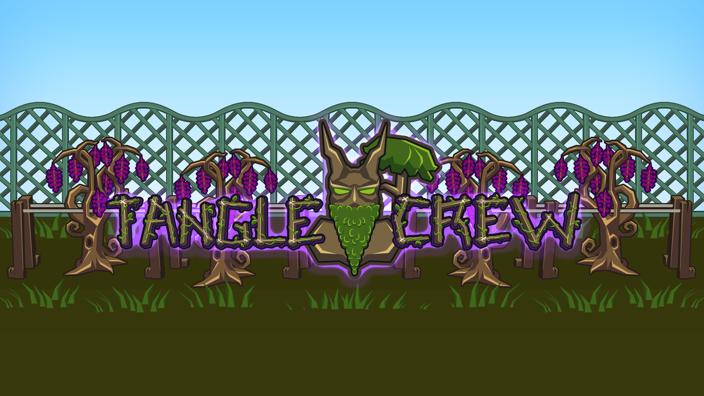

# Tanglebot

A Discord bot built for the **Tangle Crew** clan in [Old School RuneScape](https://oldschool.runescape.com/).

> **This bot was built with the assistance of [Claude](https://claude.ai/) by Anthropic — an AI coding assistant that helped design, write, debug, and iterate on all of the features described below.**

---

## Tangle Crew

| | |
|---|---|
| **Discord** | [https://discord.gg/tanglecrew](https://discord.gg/tanglecrew) |
| **Wise Old Man** | [wiseoldman.net/groups/12447](https://wiseoldman.net/groups/12447) |
| **OSRS Clan Finder** | [https://osrsclanfinder.com/clans/tangle-crew](https://osrsclanfinder.com/clans/tangle-crew) |

---

## Commands

| Command | What it does | Who can use it |
|---|---|---|
| [`/spinwheel`](#-spinwheel--prize-wheel) | Animated prize wheel that picks random winners | Coordinator |
| [`/donationhighscore`](#-donationhighscore--donation-high-scores) | Logs donations, posts the leaderboard, manages tier roles | Templar |
| [`/pethighscore`](#-pethighscore--pet-high-scores) | Logs pets, posts the leaderboard, manages the Pet Master role | Templar (`new`: Owner) |
| [`/refreshboards`](#-refreshboards--refresh-leaderboards) | Reposts both leaderboards from their sheets | Templar |
| [`/lfg-roles`](#-lfg-roles--activity-ping-roles) | Opt in/out of activity ping roles | Everyone |
| [`/lfg-post`](#-lfg-post--looking-for-group) | Creates an LFG group post in the forum | Everyone |
| [`/submission`](#-submission--proof-submission-help) | Proof formats, latest accepted proof, intake URL | Everyone (URL subcommands: Manage Server) |
| [`/channelmap`](#-channelmap--channel-id-for-the-web-panel) | Shows a channel's ID for the web panel | Manage Server |
| [`/weeklycomp`](#-weeklycomp--discord-event--wise-old-man-competitions) | Creates a Discord event plus WOM competitions | Templar |
| [`/weeklycompstats`](#-weeklycompstats--competition-leaderboard) | Standings for the running WOM competitions | Everyone |
| [`/weeklyannounce`](#-weeklyannounce--weekly-winners-and-announcements) | Schedules the weekly winners and announcements post for 5 minutes after the next competition ends | Templar |
| [`/stalemembers`](#-stalemembers--inactive-clan-members) | Lists WOM group members who were inactive or gained too little XP over a number of months | Templar (posts in the admin log) |
| [`/honeypot`](#honeypot-channel-trap) | Test mode for the honeypot trap | Owner or Templar |

Role checks for **Templar** and **Owner** on the high score commands and `/refreshboards` fail **open**: if `TEMPLAR_ROLE_ID` / `OWNER_ROLE_ID` is unset, anyone can use them. `/spinwheel`, `/weeklycomp`, `/weeklyannounce`, `/stalemembers` and `/honeypot` fail **closed**: if their role ID is unset, no one can.

---

### 🎡 `/spinwheel` — Prize Wheel

Spins an animated wheel and picks one or more random winners, for giveaways, loot splits, event prizes, or picking an activity.

| Option | Required | Description |
|--------|----------|-------------|
| `entries` | Yes | Comma-separated names or numeric ranges, e.g. `Alice,Bob,Carol`, `1-10`, or `Alice,1-5,Bob`. 2–50 entries after ranges expand. |
| `title` | No | Label on the wheel (default `Wheel Spin`) |
| `winners` | No | Winners to pick, 1–10 and fewer than the number of entries (default 1) |
| `message` | No | Win message, with `{winner}` as a placeholder (default `Winner is {winner}`) |
| `shuffle` | No | Shuffle the entries before spinning (default false) |
| `ping` | No | `@here` or `@everyone` when the winner is announced |

Ranges count either way (`5-1` counts down). Labels longer than 16 characters are cut short on the wheel.

**Requires** `COORDINATOR_ROLE_ID`.

<details>
<summary><strong>How it works</strong></summary>

1. The bot posts a GIF of the wheel spinning and easing to a stop on the first winner.
2. When the GIF finishes, it edits the message to show the winner(s) and every entry.
3. If `ping` was set, it sends the ping as a separate message, since edits don't notify.

</details>

---

### 💰 `/donationhighscore` — Donation High Scores

Tracks each member's total GP donated in PostgreSQL (or a Google Sheet, see [Database](#database)), posts a ranked leaderboard, and assigns stacking donation tier roles (Zenyte / Onyx / Dragonstone / Diamond / Ruby).

| Subcommand | Description |
|------------|-------------|
| `add` | Adds an amount to a member's total |
| `remove` | Subtracts an amount (never below 0) |

Both take a `player` and an `amount`: a raw number or shorthand like `10k`, `10m`, `10.1m` or `1b`.

<details>
<summary><strong>Environment variables</strong></summary>

| Variable | Required | Description |
|---|---|---|
| `DONATIONS_CHANNEL_ID` | Yes | Channel for the leaderboard. The command isn't loaded without it. |
| `DATABASE_URL` | Recommended | PostgreSQL connection string. See [Database](#database). |
| `DONATIONS_SHEET_ID` | Without `DATABASE_URL` | The Google Sheet's ID. Only needed for the Sheets fallback and `/migration`. |
| `GOOGLE_SERVICE_ACCOUNT_JSON` | Without `DATABASE_URL` | See [Google service account](#google-service-account). Only needed for the Sheets fallback and `/migration`. |
| `TEMPLAR_ROLE_ID` | Recommended | Restricts the command to Templars (fails open). |
| `DONATION_<TIER>_THRESHOLD` | No | GP needed per tier. Defaults: Zenyte 1B, Onyx 600M, Dragonstone 300M, Diamond 150M, Ruby 75M. |
| `DONATION_<TIER>_ROLE_ID` | No | Role granted at each tier. Leave blank to skip that tier's role. |
| `DEFAULT_EMBED_COLOR` | No | Embed color (default `006400`). |

`<TIER>` is `ZENYTE`, `ONYX`, `DRAGONSTONE`, `DIAMOND` or `RUBY`.

</details>

<details>
<summary><strong>How it works</strong></summary>

1. In one database transaction: saves the member's current display name, changes their total in the `donations` table (never below 0) and adds a `donation_log` row with the change, the new total and who ran the command. With the Sheets fallback it reads the member's row from the `Donations` tab (by Discord ID), or adds one, then writes the new total back.
2. Clamps `remove` at 0 and says so in the reply.
3. Grants every tier role the new total qualifies for (a Zenyte donor also keeps Onyx, Dragonstone, Diamond and Ruby) and removes the rest.
4. Rebuilds the leaderboard: the combined total as the heading, then one line per donor with their highest tier's emoji, **display name** and total. The top donor's line is larger.
5. Edits the existing leaderboard messages in place. If the stored message IDs are missing, it finds its previous post in the channel's recent history instead of posting a duplicate.

Display names are refreshed from the server on every post. Members who left keep their last stored name.

</details>

<details>
<summary><strong>Setup (Google Sheets fallback)</strong></summary>

Skip this when you use [the database](#database).

1. Import `Tanglebot/example/donationhighscores_template.xlsx` at [sheets.google.com](https://sheets.google.com) with **File → Import → Upload → Create new spreadsheet**. Other import options can leave it in Office mode, which the Sheets API rejects with `must not be an Office file`. Keep the `Donations` tab name (`DiscordID`, `DisplayName`, `Donated` columns) and clear the example rows.
2. Share the sheet with your [service account](#google-service-account) as an **Editor**.
3. Set `DONATIONS_SHEET_ID` (from the URL: `docs.google.com/spreadsheets/d/<THIS_PART>/edit`) and `DONATIONS_CHANNEL_ID`.
4. Optionally set the tier thresholds and role IDs.

> The bot needs **Manage Roles**, with its role above the tier roles.

</details>

---

### 🐾 `/pethighscore` — Pet High Scores

Tracks which OSRS pets each member has in PostgreSQL (or a Google Sheet, see [Database](#database)), posts a ranked leaderboard, and grants a Pet Master role at a set pet count.

| Subcommand | Description |
|------------|-------------|
| `add` | Adds up to five pets to a member (`user`, `pet`, `pet2`–`pet5`) |
| `remove` | Removes up to five pets from a member |
| `new` | Adds a new pet type (`name`, `emoji`) to the pet catalog (the `pets` table, or the `Pets` tab) — **Owner only** |

Pet slots autocomplete and skip pets picked in another slot. Once `user` is set, `add` only suggests pets the member doesn't have and `remove` only suggests pets they do. For `new`, paste the custom emoji or its numeric ID. The pet is available in autocomplete immediately.

<details>
<summary><strong>Environment variables</strong></summary>

| Variable | Required | Description |
|---|---|---|
| `PET_HIGHSCORES_CHANNEL_ID` | Yes | Channel for the leaderboard. The command isn't loaded without it. |
| `DATABASE_URL` | Recommended | PostgreSQL connection string. See [Database](#database). |
| `PET_HIGHSCORES_SHEET_ID` | Without `DATABASE_URL` | The Google Sheet's ID. Only needed for the Sheets fallback and `/migration`. |
| `GOOGLE_SERVICE_ACCOUNT_JSON` | Without `DATABASE_URL` | See [Google service account](#google-service-account). Only needed for the Sheets fallback and `/migration`. |
| `TEMPLAR_ROLE_ID` | Recommended | Restricts `add`/`remove` to Templars (fails open). |
| `OWNER_ROLE_ID` | Recommended | Restricts `new` to Owners (fails open). |
| `PET_MASTER_ROLE_ID` | No | Role granted at `PET_MASTER_THRESHOLD` pets. Leave blank to skip. |
| `PET_MASTER_THRESHOLD` | No | Pets needed for Pet Master (default 10). |
| `DEFAULT_EMBED_COLOR` | No | Embed color (default `006400`). |

</details>

<details>
<summary><strong>How it works</strong></summary>

1. Adds or removes every given pet in one database transaction (one sheet write with the Sheets fallback), skipping pets already owned (`add`) or not owned (`remove`) and noting them in the reply. Each pet changed gets a `pet_log` row with who ran the command. Pets show in catalog order (the `Pets` tab's row order, kept by the import).
2. Rebuilds the leaderboard sorted by pet count: 🥇🥈🥉 for the top three (ties share a medal), the member's **display name** and count, then a large row of their pet emojis.
3. Edits the existing leaderboard messages in place, the same way as `/donationhighscore`.
4. Grants or removes Pet Master when the member's count crosses the threshold.

</details>

<details>
<summary><strong>Setup (Google Sheets fallback)</strong></summary>

Skip this when you use [the database](#database). With the database, the import copies the `Pets` catalog over and `/pethighscore new` adds to it.

1. Import `Tanglebot/example/pethighscores_template.xlsx` the same way as the donations template. Keep both tab names:
   - `Highscores` — `DiscordID`, `DisplayName`, `Pets`. `Pets` is a comma-separated list of pet **keys** (e.g. `baby_mole, heron`), not names.
   - `Pets` — `Key`, `Name`, `EmojiID`, pre-filled with every pet. Row order is display order.
2. Share the sheet with your [service account](#google-service-account) as an **Editor**.
3. Set `PET_HIGHSCORES_SHEET_ID` and `PET_HIGHSCORES_CHANNEL_ID`, and optionally `PET_MASTER_ROLE_ID` / `PET_MASTER_THRESHOLD`.
4. Fill in each pet's `EmojiID` with its custom emoji ID. Pets without one show ❔.

Hand edits to the `Pets` tab take effect on the next restart or `/refreshboards`. Pets added with `/pethighscore new` are available immediately.

> The bot needs **Manage Roles**, with its role above Pet Master.

</details>

---

### 🔄 `/refreshboards` — Refresh Leaderboards

Reposts the pet and donation leaderboards from the database (or from their Google Sheets when `DATABASE_URL` is unset), e.g. after the import or after editing a table or sheet by hand. The reply says whether each board was refreshed, skipped (env vars not set) or failed, with the error. The same refresh runs on startup.

Loads with `DATABASE_URL`, or with `GOOGLE_SERVICE_ACCOUNT_JSON` when there is no database. Restricted to Templars (`TEMPLAR_ROLE_ID`, fails open).

---

### 🚚 `/migration` — Move the Sheets into the Database

Owner-only (`OWNER_ROLE_ID`) tools for the one-off move from the Google Sheets to PostgreSQL. This is the only way the data is moved: nothing is imported at startup or on a schedule. Replies are private. The command only loads while `DATABASE_URL`, `GOOGLE_SERVICE_ACCOUNT_JSON`, `DONATIONS_SHEET_ID`, `PET_HIGHSCORES_SHEET_ID` and `OWNER_ROLE_ID` are all set. The steps in order are under [Moving from the sheets](#database).

| Subcommand | What it does | Writes? |
|------------|--------------|---------|
| `dbconnection` | Connects to the database and shows the PostgreSQL version, the database and user, how long the round trip took, and which migrations are applied or still pending. | Nothing |
| `sheets` | Reads the `Donations`, `Highscores` and `Pets` tabs and shows how many members and how much GP are on the donations tab, how many members and pets owned are on the highscores tab, the catalog size, and any pet keys missing from the catalog (the import skips those). | Nothing |
| `status` | Shows what the database holds now: donors and GP, members with pets and pets owned, catalog size, members stored, when the last import ran, and how many donation changes commands or hand edits have made since. | Nothing |
| `dryrun` | Runs the whole import and the check inside a transaction, shows the same report as `import`, then undoes everything. | Nothing (rolled back) |
| `import` | Copies the sheets into the database in one transaction (a failure writes nothing): the pet catalog in sheet order, every member, each donation total with one `import` row in `donation_log`, and each member's pets. It then checks the result against the sheets member by member and reposts both leaderboards. `confirm` must be True, or nothing happens. | Database only |
| `verify` | Compares the sheets with the database member by member (donation totals, pet lists, and the catalog's names, emoji IDs and order) and lists every difference. Members changed by a command since the import, pets added since, and skipped pet keys are shown as notes, not differences. | Nothing |

The sheets are only ever read. Only one import runs at a time. Running `import` again is safe: totals and the catalog are updated, a new `donation_log` row is added only if a total changed, and a member whose donations or pets were changed by a command since the first import is left alone, with a warning.

---

### 🔔 `/lfg-roles` — Activity Ping Roles

Opens a private menu for opting in to ping roles for bosses, raids and minigames, so members only get pinged for what they care about. Groups made with `/lfg-post` ping these roles.

<details>
<summary><strong>How it works</strong></summary>

1. The menu has a button per category (**Bosses**, **Raids**, **Minigames**) and **Clear All LFG Roles**.
2. A category opens its activities in alphabetical order. Clicking one toggles its role. Roles you have show red.
3. Menus delete themselves after 60 seconds. Your roles stay.
4. Anyone can `@mention` a role to ping everyone who opted in.

</details>

<details>
<summary><strong>Setup</strong></summary>

Activities are defined in `CATEGORIES` in `src/utils/roleMenu.js`. Each role (`LFG-<activity>`, e.g. `LFG-Yama`) is created on first use with the activity's color, plus its emoji as the role icon on servers with role icons (Boost Level 2+). On startup, if `CLAN_ID` is set, the bot applies `CATEGORIES` colors and icons to existing `LFG-` roles.

The bot needs **Manage Roles**, with its role above the `LFG-` roles. `ADMIN_LOG_CHANNEL_ID` (optional) receives role errors and misconfigured activities.

</details>

---

### 🔍 `/lfg-post` — Looking For Group

Creates a forum post where members can join a group for an activity, with a role ping, a live member list, a queue, and automatic cleanup.

<details>
<summary><strong>Environment variables</strong></summary>

| Variable | Required | Description |
|---|---|---|
| `LFG_FORUM_CHANNEL_ID` | Yes | Forum Channel for group posts. The command isn't loaded without it. |
| `COORDINATOR_ROLE_ID` / `OWNER_ROLE_ID` | No | Staff who can Start Now, Disband, Cancel Disband, Manage and confirm Still Here on any group. Anyone with `COORDINATOR_ROLE_ID` is exempt from the 2-open-groups limit. |
| `LFG_LOG_CHANNEL_ID` | No | Receives a line when each group closes. Defaults to `ADMIN_LOG_CHANNEL_ID`. |
| `ADMIN_LOG_CHANNEL_ID` | No | Receives setup errors and a line for each finished group. |

</details>

<details>
<summary><strong>How it works</strong></summary>

1. A private menu asks for **Category** → **Activity** → **Group Size** (up to the activity's max, some with a **Mass** option) → **Start Time** (Now, 15 or 30 minutes, or 1–6 hours from now), then an optional description.
2. The bot creates a post titled like `[Open] - Bosses: Yama - Start: in 15 Min`, pinging the activity's role and listing the details and members. The title's countdown updates as the start approaches, and `[Open]` becomes `[Full]` when the group fills.
3. Buttons on the post:
   - **Join Group** — joins, or joins the queue if the group is full.
   - **Leave Group** — leaves the group or the queue.
   - **Start Now** — starts the group immediately (members or staff).
   - **Manage** — remove a member (they're pinged, with who removed them), or edit the description, start time or size. Each change is announced in the thread.
   - **Disband Group** — closes the post after a 1-minute grace period with a **Cancel Disband** button (members or staff; anyone in the group or queue can cancel).
4. Joins and leaves post a notice without pinging the group. Filling up pings everyone with "Group formed, Good luck!"
5. When a spot frees up in a full group, the first person in the queue gets **Accept Spot** / **Decline Spot** for 5 minutes. Declining or not answering removes them from the queue, and the spot goes to the next person. With nobody queued, the group reopens.
6. An empty group closes after 15 minutes unless someone rejoins. A closed group's post is renamed `[Closed]`, locked and archived rather than deleted, a line is posted to `LFG_LOG_CHANNEL_ID` (or the admin log), and the group is appended to `Tanglebot/data/lfg-history.jsonl` with everyone who joined, when it was created and why it closed (`empty`, `disbanded` or `inactive`). The bot needs **Manage Threads**.
7. Members are pinged when the start time arrives (not after **Start Now**).
8. Every 2 hours, starting no earlier than the start time, the group is asked if it's still active. No **Still Here** click within 10 minutes disbands it.
9. On startup the bot posts or updates a pinned **Start Here** post in the forum explaining all of this. It has a **Make a Suggestion** button (shown when `ADMIN_LOG_CHANNEL_ID` is set): a form with a Boss/Raid/Minigame/Other picker and a name field, posted to the admin log, with an `OWNER_ROLE_ID` ping if that's set. One suggestion per person per minute.

Members and Coordinators/Owners can use every button. Each person can have 2 open groups (Coordinators are exempt), and starting a group for an activity that already has an open group with space shows a **Join the existing one** / **Create anyway** choice.

Groups survive restarts: each change is saved to `Tanglebot/data/lfg-groups.json`, and on startup the bot restores them and restarts their timers from that moment. A group that was closing gets a fresh 1-minute countdown with **Cancel Disband**, an empty one a fresh 15 minutes, and a spot held for the queue is offered again. If the save file doesn't have a group, the bot rebuilds it from its post in the forum; posts it can't read get their buttons removed, and the admin log lists both.

</details>

<details>
<summary><strong>Setup</strong></summary>

Point `LFG_FORUM_CHANNEL_ID` at a Forum Channel. The bot needs **Manage Threads** there, and **Manage Roles** for the activity roles (shared with `/lfg-roles`). A forum tag named after an activity (e.g. `Yama`) is applied to its posts automatically.

</details>

---

### 🔗 `/link` and `/linkalt` — Verified Clan Account Linking

Associates the Discord member running the command with an active account in the clan Wise Old Man roster.

| Command | Description |
|---|---|
| `/link rsn:<name>` | Links the RSN as the member's primary account. |
| `/linkalt rsn:<name>` | Adds the RSN to the member's existing profile as an alternate account. A primary link must exist first. |

Both commands reply privately with a single-use website confirmation link that expires after 15 minutes. The user must sign into the existing clan website with the same Discord account that ran the command. Typing an RSN alone never transfers ownership. Accounts already associated with another Discord ID are rejected and must be corrected by an administrator.

<details>
<summary><strong>Environment variables</strong></summary>

| Variable | Required | Description |
|---|---|---|
| `SUPABASE_URL` | Yes | Existing Supabase project URL. |
| `SUPABASE_SERVICE_ROLE_KEY` | Yes | Server-only key used to create a Discord-bound challenge. Never expose this in the website. |
| `CLAN_ROSTER_COMMANDS_ENABLED` | Yes | Set to `true` after applying all three roster migrations and deploying the website. Defaults off. |
| `CLAN_WEBSITE_URL` | No | Website origin used in the confirmation link. Defaults to `https://tanglecrew.group`. |

</details>

All four roster commands load/register only when both Supabase variables are present and `CLAN_ROSTER_COMMANDS_ENABLED=true`. Values such as `false` do not enable them. Run `npm run deploy` and restart after enabling. Blank or whitespace-only `CLAN_WEBSITE_URL` values use the default website. The database migration `20260917140000_add_verified_clan_account_linking.sql` and the matching website deployment are required before enabling them.

---

### 📋 `/rankreview` — Rank Review Summary

Generates the administrator-facing “Members requiring rank review this week” Discord summary from rules configured in `/admin/roster`. It includes the current and recommended ranks, clan tenure, and time in the current rank. Recommendations never change ranks automatically.

The command requires **Manage Server**, uses the same `SUPABASE_URL` and `SUPABASE_SERVICE_ROLE_KEY`, and defaults to a private reply. Set `private:false` explicitly to publish the report in the current channel. The database migration `20260917150000_add_configurable_rank_reviews.sql` is required.

---

### 👥 `/gimrolesync` — Group Ironman Roles

Synchronizes configured GIM roles against the complete plan. One bulk member fetch includes existing role holders, so former, inactive, or unlinked roster members lose stale GIM roles. Assignments for the same Discord identity are merged: main/alt accounts in different groups retain all assigned GIM roles, without changing unrelated roles. Invalid Discord IDs are reported and skipped. Missing permissions, uneditable roles, and failed changes are reported rather than counted as already correct. A time budget stops additional work before the interaction expires and reports remaining members for another run.

The command requires **Manage Roles**, replies privately with an update/error summary, and never creates or deletes Discord roles. The bot needs Manage Roles, the Server Members intent, and a role above every configured GIM role. `CLAN_ROSTER_COMMANDS_ENABLED=true` is required. It uses the existing Supabase server credentials and requires `20260917160000_add_clan_gim_groups.sql`.

---

### 🧾 `/submission` — Proof Submission Help

| Subcommand | Description |
|------------|-------------|
| `format` | Posts the KC and drop proof formats |
| `last` | Shows the latest accepted proof submission |
| `showintakeurl` | Shows the KC intake URL in use (Manage Server) |
| `setintakeurl` | Overrides the intake URL without a restart (Manage Server) |

`format` and `last` reply publicly unless `private` is set. The URL subcommands always reply privately. The override is saved in `Tanglebot/data/` and takes precedence over `SUPABASE_DISCORD_KC_INTAKE_URL`.

`last` only has something to show once [KC and Drop Proof Intake](#kc-and-drop-proof-intake) has accepted a submission.

---

### 🧭 `/channelmap` — Channel ID for the Web Panel

Replies privately with a channel's ID (the current channel, or the `channel` option) and the values to set on its `event_discord_channels` row in the web panel. Requires **Manage Server**.

---

### 🏆 `/weeklycomp` — Discord Event + Wise Old Man Competitions

Creates a Discord scheduled event and **one** Wise Old Man competition for the chosen bosses or skills, in one step. All metrics must be the same type (all skills or all bosses), as WOM requires; mixing them is rejected, so run the command once per type.

| Option | Required | Description |
|--------|----------|-------------|
| `prefix` | Yes | Name prefix. A competition is named `<prefix> <metric>`, e.g. `BOTW T3 Vorkath`, without a leading "The". With several metrics it is named just `<prefix>` (e.g. `BOTW T2: God Wars Dungeon`) and the metrics are listed in the Discord event description. |
| `metric` | Yes | Boss or skill. Autocompletes over every boss and skill WOM tracks. |
| `metric2`–`metric4` | No | More bosses or skills. Must be the same type as `metric` (skill or boss). All the metrics are tracked in the one competition and their gains are added together. |
| `start` | Yes | Eastern Time date: `YYYY-MM-DD`, `YYYY/MM/DD` or `MM/DD/YYYY`, optionally with an hour (`18` or `6pm`). ISO 8601 with an offset also works. Must be in the future. |
| `duration` | No | Days, 1–365 (default 7). |
| `group_id` | No | WOM group ID. Only shown when `WOM_GROUP_ID` isn't set. |
| `verification_code` | No | WOM verification code. Only shown when `WOM_GROUP_VERIFICATION_CODE` isn't set. |

Replies privately. **Requires** `TEMPLAR_ROLE_ID`.

<details>
<summary><strong>Environment variables</strong></summary>

| Variable | Required | Description |
|---|---|---|
| `TEMPLAR_ROLE_ID` | Yes | The role that can run the command, and the role the ending reminder pings. |
| `WOM_GROUP_ID` | Recommended | Your WOM group. Also enables the ending reminder. |
| `WOM_GROUP_VERIFICATION_CODE` | Recommended | wiseoldman.net → your group → settings → Verification Code. Also used by the reminder's update all. |
| `WOM_API_KEY` | No | Raises WOM's rate limit from 20 to 100 requests a minute. Ask on the Wise Old Man Discord. |
| `ADMIN_LOG_CHANNEL_ID` | No | Logs each run and any failures, and receives the ending reminder. |

</details>

<details>
<summary><strong>How it works</strong></summary>

1. Shows a private confirmation with the metrics, start, end and duration. Nothing is created unless **Confirm** is clicked within 60 seconds.
2. Creates the one WOM competition tracking every chosen metric in the group, so its members are tracked automatically.
3. Creates a Discord event named after the competition. The description is `<title>: <competition link>`, followed by one line per metric when there are several. The cover is the WOM background of the first chosen metric that has one (Mimic has none), else WOM's generic icon.
4. Replies with the links and logs to the admin log. If the event fails after the competition was created, the reply and the log give the competition link.

</details>

<details>
<summary><strong>Competition ending reminder (automatic)</strong></summary>

Every 15 minutes (on the quarter hour, and once on startup) the bot checks the WOM group for competitions ending within the hour. For those it finds, it:

1. Runs **update all** on the group, then waits 5 minutes if any players were queued.
2. Posts **one** message in `ADMIN_LOG_CHANNEL_ID` pinging `TEMPLAR_ROLE_ID`, with the top 3 of each ending competition.
3. Adds a combined top 5 for each category (bossing, skilling, …) with two or more ending competitions.

Each competition is reminded once. The bot checks the admin log channel for its earlier reminders, so this survives restarts and deploys. It needs **Read Message History** in that channel, or no reminder is sent.

Needs `WOM_GROUP_ID` and `ADMIN_LOG_CHANNEL_ID`.

</details>

---

### 📊 `/weeklycompstats` — Competition Leaderboard

Shows the standings for every WOM competition the group is running. Anyone can use it; the reply is public. Each person can run it once a minute.

| Option | Required | Description |
|--------|----------|-------------|
| `player` | No | A RuneScape name. Opens on that player's page, highlights them, and shows their rank on each leaderboard. Autocompletes from the last fetched standings. |

<details>
<summary><strong>Environment variables</strong></summary>

| Variable | Required | Description |
|---|---|---|
| `WOM_GROUP_ID` | Yes | Your WOM group. The command isn't loaded without it. |
| `WOM_API_KEY` | No | Raises WOM's rate limit from 20 to 100 requests a minute. |
| `ADMIN_LOG_CHANNEL_ID` | No | Receives an alert, naming who ran the command, when loading or replying fails. |

</details>

<details>
<summary><strong>How it works</strong></summary>

1. Lists each running competition with its total (**Total KC** for bosses, **Total gained** otherwise) and active participants (e.g. `43/264 active`). ⏰ marks competitions ending within 24 hours. Times use Discord timestamps, so they show in each viewer's timezone.
2. Competitions in the same category are summed per player, with each competition's gains shown underneath (or each metric's, for a competition tracking several metrics). Categories are never mixed and sit side by side.
3. Players with gains are listed 10 per page, with 🥇🥈🥉 for the top 3. Ties share a rank.
4. **◀ Prev** / **Next ▶** work for 14 minutes, only for whoever ran the command.
5. If nothing is running, it names the next competition(s) and when they start.

Standings are fetched at most every 5 minutes and shared between runs; sooner when a competition starts or ends or `/weeklycomp` creates one, and 1 minute after an error. Gains are only as fresh as each player's last WOM update. The command doesn't run update all.

</details>

---

### 📣 `/weeklyannounce` — Weekly Winners and Announcements

Schedules one post for 5 minutes after the next clan competition ends, so WOM's final totals are in: a **winners** message with the top 3 and a progress chart, then an **announcements** message with up to 5 staff-written announcements. Run `/weeklyannounce setup` once a week; nothing is scheduled until you preview the post and press **Accept**. Replies privately. **Requires** `TEMPLAR_ROLE_ID`, `WOM_GROUP_ID` and `ADMIN_LOG_CHANNEL_ID`.

| Option | Required | Description |
|--------|----------|-------------|
| `channel` | Yes | Where to post. Only shown when `WEEKLY_ANNOUNCE_CHANNEL_ID` isn't set. The bot needs **View Channel**, **Send Messages**, **Attach Files** and **Mention Everyone** there, since the winners message pings @everyone. |
| `start` | No | Send time, Eastern Time, in the same formats as `/weeklycomp` (`YYYY-MM-DD`, `YYYY/MM/DD` or `MM/DD/YYYY`, optionally with `18` or `6pm`). Must be in the future. Leave it blank to send 5 minutes after the next competition in the WOM group ends. |

<details>
<summary><strong>Environment variables</strong></summary>

| Variable | Required | Description |
|---|---|---|
| `TEMPLAR_ROLE_ID` | Yes | Who can run the command and use its panel (fails closed). The command isn't loaded without it. |
| `WOM_GROUP_ID` | Yes | The group whose competitions are read. The command isn't loaded without it. |
| `ADMIN_LOG_CHANNEL_ID` | Yes | Receives each scheduled post, each send, late sends and failures. The command isn't loaded without it. |
| `WEEKLY_ANNOUNCE_CHANNEL_ID` | Recommended | The channel the post goes to. When set, the command has no `channel` option. |
| `WOM_API_KEY` | No | Raises WOM's rate limit, which makes the preview and the chart load faster. |

</details>

<details>
<summary><strong>Building the post</strong></summary>

1. A private panel shows the channel, the send time and an `N / 2,000` character count for the announcements. Past 2,000 the panel turns amber.
2. The first row, **Weekly winners, top 3 with chart**, names the competitions it uses, by default all those ending next. Its menu lists the group's competitions still to end, so you can untick some or pick others; the post sends 5 minutes after the last picked one ends. With a typed `start`, the send time stays as typed, the menu lists every competition started by then, and **Automatic** picks the ones that last ended by the send time. If WOM can't be reached, a typed `start` still works, with Automatic and no menu.
3. **Add announcement (n/5)** opens a box for up to 2,000 characters. Paste the announcement as you want it posted: Discord formatting (`**bold**`, `# headers`, `> quotes`, lists), emojis and pings are kept. Raw mentions (`<@&id>`, `<#id>`, `<:name:id>`) work, and plain `@Role Name` and `#channel-name` are turned into real mentions when the server has that role or channel.
4. Each announcement has **Edit**, **Up**, **Down** and **Remove**. They're joined in order, with a blank line between them.
5. Drafts are saved, so the panel keeps working after a restart. Any Templar can use its buttons. Drafts left untouched for 14 days are deleted.

</details>

<details>
<summary><strong>Preview and approval</strong></summary>

**Preview** privately posts both messages exactly as they'll be sent, without pinging anyone, then a check list:

- The announcements' length, and whether they fit in one message.
- That the send time is in the future.
- Who it pings, with a warning if the bot can't ping them.
- Whether a chart is attached. Before the competition ends, the winners and chart are the standings so far; the final results are loaded when it sends. If a picked competition will still be running at the send time, it warns that the post won't have the final results.
- Which winners matched a server member and will be pinged, and which are shown by RSN instead.
- Any section without a pet emoji, and why.

Under it, **Accept** schedules the post and logs who scheduled it, the channel, the send time and a summary to the admin log. **Edit** goes back to the panel with everything kept, and **Cancel** discards the draft.

Announcements over 2,000 characters are sent as **2 messages** back to back, split between announcements (never in the middle of one). Accept then reads **Accept and send announcements as 2 messages**. If they wouldn't fit in two, or the send time has passed, Accept is disabled.

</details>

<details>
<summary><strong>Winners and chart</strong></summary>

- **Competitions:** the ones picked on the panel, by default all those ending next. With **Automatic** picked, the ones that last ended by the send time.
- **Merging:** competitions that end together are added into one list when they share a unit (kc with kc, xp with xp) and a name prefix, e.g. `BOTW T3 Gauntlet` and `BOTW T3 Corrupted Gauntlet`. Others get their own section and chart in the same message.
- **Format:** a "Hello @everyone" intro, then per list a heading with the boss's pet emoji and the title linked to WOM (each name linked in a merged list), the clan's total, 🥇🥈🥉 with each winner's gains, and a line asking 1st place to contact @Templar for their BOTW (or SOTW, as the title says) winnings.
- **Places:** 1st to 3rd. Tied players share a line, and a tie for 2nd leaves no 3rd. If nobody gained anything, the section says so and has no chart.
- **Mentions:** each winner's RSN is matched to a server member by nickname, display name or username, ignoring case, spaces, `_` and `-`. A name that starts with the RSN also counts ("Snow I 🍌x14" for `Snow I`) when nobody matches exactly. RSNs matching nobody, or more than one member, are shown in bold without a ping.
- **Emojis:** the heading uses the bot's own emoji (Developer Portal → Emojis) named after the boss's pet, e.g. `Youngllef` for the Gauntlet. Only letters and digits are compared, and a leading "Pet" or trailing "icon" is ignored (`Snakeling` for Pet snakeling, `Archive_Guardian_icon` for the Archive guardian). The boss-to-pet list is in `src/utils/bossPets.js`.
- **Chart:** one point per day from start to end. Everything is gained since the start, not lifetime totals. The top 5 players are lines, with their gains in the legend (`+212 kc`), and the clan's total gains are a dashed white line, all on one scale so the total is always highest.
- **Data:** WOM only records a player when they're updated, so a line can start late and the total can jump near the end.

</details>

<details>
<summary><strong>Sending</strong></summary>

1. At the send time the bot loads fresh results from WOM, draws the charts, and posts the winners message, then the announcements. Both are plain messages and ping as written: the winners message pings @everyone, the matched winners and @Templar.
2. If WOM can't be reached, it retries 3 times, 2 minutes apart, then sends the announcements without the winners.
3. Each send is reported to the admin log with links to the messages, noting any winners shown without a ping and headings without an emoji, or with the error and what was already posted if it fails.
4. A post sends **once**. Scheduled posts survive restarts. If the bot was down at the send time, it sends as soon as it's back, with a "sending late" alert. If a send was interrupted, the rest is sent 15 minutes later, without repeating what was already posted.

This feature's WOM calls run one at a time to stay inside WOM's rate limit: one competition takes about 8 calls, roughly 30 seconds without `WOM_API_KEY`. Drafts and scheduled posts are kept in `data/weeklyannounce.json`, which the Docker setup already keeps between restarts.

</details>

---

### 💤 `/stalemembers` — Inactive Clan Members

Lists every member of the WOM group who has been inactive or gained less than a set amount of overall XP over the last few months, in two lists, longest inactive first. For example, `/stalemembers time: 6 minxp: 250k ignore: Owner, Deputy Owner, Templar` lists everyone outside those ranks who hasn't been active in 6 months (plus anyone within 2 weeks of it), then everyone active more recently who gained less than 250k XP. It's posted as a header with the options, totals and main buttons, then each list that has anyone in it as its own message with its own pages. It's always posted in the admin log channel, for everyone there to see. Run from any other channel, it's still posted there and you get a private reply with a link to it. Errors reply privately. **Requires** `TEMPLAR_ROLE_ID` and `ADMIN_LOG_CHANNEL_ID`.

| Option | Required | Description |
|--------|----------|-------------|
| `time` | Yes | How many months back to check (1–60). |
| `minxp` | Yes | The XP they must have gained, at least 1, e.g. `250k`, `1.5m` or `250,000`. |
| `ignore` | No | Clan ranks to leave out, comma separated, e.g. `Owner, Templar, Gnome Child`, or `None` to check every rank. Uses WOM's rank names, in any case. Autocompletes from the ranks the group uses, in rank order; any WOM rank can still be typed in full, but only the group's show in the header. Leave it empty to tick the ranks from a list instead (see below). |

**Rank picker:** run it without `ignore` (e.g. `/stalemembers time: 6 minxp: 250k`) and you privately get a tick box of the clan's ranks, with their emojis and names, and a **▶ Run** button. As you tick ranks, the message lists them by emoji and name (the closed tick box only shows emojis) and shows the matching command with `ignore` filled in, ready to copy and paste next time. Run posts the list as usual and leaves you the link and the command. The picker works for Templars only, and after a restart too.

<details>
<summary><strong>Environment variables</strong></summary>

| Variable | Required | Description |
|---|---|---|
| `TEMPLAR_ROLE_ID` | Yes | The role that can run the command and use its buttons. The command isn't loaded without it. |
| `ADMIN_LOG_CHANNEL_ID` | Yes | Where every list is posted, wherever the command is run. Also receives an alert, naming who ran the command, when loading or replying fails. The command isn't loaded without it. |
| `WOM_GROUP_ID` | Yes | Your WOM group. The command isn't loaded without it. |
| `WOM_GROUP_VERIFICATION_CODE` | No | Enables the 🔃 Refresh WOM button, which runs update all on the group. |
| `WOM_API_KEY` | No | Raises WOM's rate limit from 20 to 100 requests a minute. |

</details>

<details>
<summary><strong>How it works</strong></summary>

1. Loads the group's members and their overall XP gained over the window from WOM (2 requests).
2. Members in an ignored rank are skipped, and so is anyone who joined the WOM group during the window, since they haven't had the whole window to gain XP. The join date is the earlier of WOM's two (when WOM added them, and the clan join the RuneLite plugin reports), so someone WOM re-added after a name change keeps their original date. The header says how many were skipped.
3. Everyone else is listed with their rank's emoji, XP gained and how long ago WOM last saw their stats change, in months and weeks (e.g. `last active 6 months, 2 weeks ago`) with the date, in two lists, each its own message under the header:
   - **😴 Inactive for 6 months**: no change since the window started. Members whose last change was in the window's first 2 weeks are listed here too as close, whatever they gained. They're marked ⌛ with when they'll have been inactive for the whole window, counting down live (e.g. `⌛ 6 months inactive in 9 days`).
   - **📉 Active, but under 250k XP**: active later in the window, but gained less than `minxp`.
4. The header counts each list, and the close members, separately. A list with nobody in it isn't posted; the header says it's empty instead.
5. Each list is sorted by that last change, oldest first. Members WOM has never seen change come first.
6. Members WOM has no data for in the window (e.g. never tracked) count as 0 XP and show **no WOM data**. ⏳ marks members WOM hasn't updated in over 7 days, so they may have gains WOM hasn't seen. ❓ marks members WOM can't track (unranked, flagged, archived or banned on WOM), whose XP may be wrong.
7. The header shows when the list was checked and by whom (in each viewer's local time), the options, the totals, what the markers mean (only the ones the lists use, so the legend changes when an Update or Refresh adds or removes one), and what the buttons do (Discord buttons can't show a description on hover). Each list shows 15 members a page with its title on every page, and any page with fewer is padded with blank lines, so both lists and all their pages are the same height.
8. The header has **🔄 Update**, **🔃 Refresh WOM** and **📄 Export all**; each list has its own **◀ Prev** / **Next ▶** and **📄 Export**. They work for any Templar, with no time limit.
   - Update reloads the lists from WOM with the same options, editing the messages in place, and keeps each list on the same page. If a list empties or gains members, the whole list is posted again in its place so the lists stay in order under the header.
   - Refresh WOM runs WOM's update all, so every member is re-checked on the hiscores, and privately says how many were queued and when the list will update, as a local time with a live countdown (e.g. "at 3:05 PM (in 5 minutes)"). When it's done, that message changes to say it finished. Update all covers the whole group, so only one refresh runs at a time: if someone presses Refresh during the wait, on any list, they're told privately who started it and when it finishes, and they're DMed too when it's done. After 5 minutes (the same wait as the competition reminder) it reloads the newest list in place and DMs everyone waiting a link to it. Anyone with DMs closed is pinged in the admin log channel instead. A bot restart during the wait cancels the reload and the message. Only shown when `WOM_GROUP_VERIFICATION_CODE` is set.
   - When another feature runs update all (the [competition ending reminder](#-weeklycomp--discord-event--wise-old-man-competitions)), the newest list also reloads on its own 5 minutes later, so that one update all serves both. The header then shows the time with "auto refreshed" (the export says what triggered it). Refresh presses during that wait join it, as above.
   - Exports are privately sent as an Excel file (`.xlsx`) that also opens in Google Sheets. A list's own Export has just that list, named `stale-members-export-<date>_<time>-inactive.xlsx` or `-low-xp.xlsx`; Export all has every list with members, a tab each, named `stale-members-export-<date>_<time>.xlsx` (UTC; a second export in the same second gets `_2`). Each tab starts with which list it is, when the data was checked and by whom, who exported it and when, and the options, then lists each member's name, rank, status (inactive, close with the date they reach the window, or active but under `minxp`), XP gained, dates and notes. A copy is saved in `data/stalemembers-exports/`, keeping the newest 5.
9. Running the command again deletes the previous list's messages once the new one is posted, so only one shows. The newest list's message IDs are saved in `data/stalemembers.json`, so this still works after a restart. If two runs finish at the same time, the later list is kept.
10. Lists are kept in memory until the bot restarts. After that, Prev, Next and Export say the list has expired and to press Update (Export all also gives the command to copy and run again, e.g. `/stalemembers time:6 minxp:250k ignore:Owner, Templar`), and Update reloads the lists from the options stored on its button.
11. If WOM can't be reached, the "thinking" message is removed and the error is shown only to whoever ran the command.

Gains are only as fresh as each player's last WOM update; 🔃 Refresh WOM brings everyone up to date first. "Last active" counts any stat change WOM saw, boss kills included, not just XP.

Rank emojis are the bot's own application emojis (uploaded from `assets/icons/clan_ranks`), matched to ranks by name and loaded once. A rank with no emoji, or every rank if loading them fails, shows its name instead.

The group's ranks are loaded from WOM on startup for autocomplete and reused for 30 minutes. If they can't be loaded, autocomplete only suggests `None`; ranks can still be typed.

</details>

---

## Message Features

### KC and Drop Proof Intake

Watches submission channels for KC and drop proof posts and forwards valid ones to the site for manual review.

<details>
<summary><strong>Environment variables</strong></summary>

| Variable | Description |
|---|---|
| `SUPABASE_URL` | Supabase project URL. |
| `SUPABASE_SERVICE_ROLE_KEY` | Used to look up `event_discord_channels`. |
| `SUPABASE_DISCORD_KC_INTAKE_URL` | Where submissions are sent. Can be overridden with `/submission setintakeurl`. |
| `DISCORD_KC_INTAKE_SECRET` | Shared secret sent with each submission. |

Set all four or none. Setting only some stops the bot at startup.

</details>

<details>
<summary><strong>How it works</strong></summary>

A channel is a submission channel if `event_discord_channels` has a row with its `channel_id` and `channel_kind = submission` (cached for a minute). In those channels, a message with an image or any proof field is treated as a submission; other chatter is ignored.

KC format (`Monster being Killed` is optional):

```text
Task name on Board: <tile title>
Monster being Killed: <monster name>
Starting or Ending: Starting
Starting Kill Count: 1234
```

Drop format:

```text
Task name on Board: <tile title>
Item Dropped: <item name>
```

Each submission needs exactly one image. For ending KC, `Starting or Ending: Ending`, `Ending Kill Count: 1234` or `Kill Count: 1234` all work. Invalid submissions get a reply with the formats. If the Supabase lookup fails, the bot asks the user to try again.

</details>

---

### Announcement Channel Cleanup

When a followed announcement's original post is deleted, Discord replaces the local copy with `[Original Message Deleted]`. The bot deletes those messages in `ANNOUNCEMENT_CHANNEL_ID`. It needs **Manage Messages** there. Leave the variable blank to disable.

---

### Honeypot Channel Trap

Turns one or more channels into traps for scam bots and compromised accounts.

<details>
<summary><strong>How it works</strong></summary>

On startup each trap channel is cleared and a warning is posted. When anyone (except bots) posts there, the bot:

1. Times them out for 1 week.
2. Deletes the message, keeping up to 10 of its images.
3. Posts a report with the images to `ADMIN_LOG_CHANNEL_ID`, with two buttons:
   - **Ban & Delete Messages** — bans the account and has Discord delete their messages from the last 7 days in every channel and thread. If the ban fails, the bot instead deletes any of their messages among the last 100 in each channel it can see.
   - **False Positive (Un-Timeout)** — lifts the timeout.

Only Owners and Templars can use the buttons. After a click, the buttons are removed and the report records the action, who took it and when.

`/honeypot testmode true` turns on test mode: the trap still reports and the buttons still work, but nobody is timed out, banned or has messages deleted. `/honeypot testmode false` turns it off, and `/honeypot status` shows the current mode.

</details>

<details>
<summary><strong>Environment variables</strong></summary>

| Variable | Required | Description |
|---|---|---|
| `HONEYPOT_CHANNEL_ID` | One of these two | A text channel to trap. |
| `HONEYPOT_VOICE_CHANNEL_ID` | One of these two | A voice channel's text chat to trap. |
| `ADMIN_LOG_CHANNEL_ID` | Recommended | Where reports go. Without it the poster is still timed out, but nothing is reported. |
| `OWNER_ROLE_ID` / `TEMPLAR_ROLE_ID` | Recommended | Who can use the buttons and `/honeypot` (fails closed). |

`/honeypot` is only loaded when a trap channel is set.

> The bot needs **Manage Messages** in each trap channel, **Moderate Members** for timeouts, and **Ban Members** for the ban button.

</details>

---

## Setup

### Prerequisites

- [Node.js](https://nodejs.org/) 22 or later (or Docker)
- A Discord application and bot token from [discord.com/developers](https://discord.com/developers/applications)
- **Server Members Intent** and **Message Content Intent** enabled for the bot. It requests both at startup and can't log in without them.

### Install

```bash
cd Tanglebot
npm install
cp .env.example .env
```

### Command visibility

Discord only lets a bot hide a slash command by permission. Staff-only commands are registered with `default_member_permissions` set to `0`, so only server admins see them until a role is allowed in. The bot still checks the real role (Templar, Coordinator, etc.) when a command runs, so this only controls what shows up in the command picker.

Role-based visibility is set by a server admin in **Server Settings > Integrations > TangleBot**. Those overrides survive the bot's re-register on startup as long as a command's name doesn't change. Visibility is per top-level command, not per subcommand, so `/submission` is shown or hidden as a whole.

Add these overrides once:

- **Templar:** `/donationhighscore`, `/pethighscore`, `/refreshboards`, `/stalemembers`, `/weeklyannounce`, `/weeklycomp`, `/honeypot`, `/submission`
- **Owner:** `/migration`
- **Coordinator:** `/spinwheel`

Owner also holds Templar, so it needs no separate override for the Templar commands. A renamed or new staff command needs its override added once. Admins always see every command.

### Environment variables

Each feature's variables are listed in its section above. These are the base ones:

| Variable | Description |
|---|---|
| `DISCORD_BOT_TOKEN` | Required. The bot won't start without it. |
| `CLIENT_ID` | Your application ID. |
| `CLAN_ID` | Your server ID. With `CLIENT_ID`, used to register the slash commands. Also used for the leaderboards and the `LFG-` role sync. |
| `ADMIN_LOG_CHANNEL_ID` | Optional. Staff channel for alerts, logs and the "Bot is online" message (which pings `OWNER_ROLE_ID` if set). |
| `OWNER_ID` | Unused. |

### Database

`/donationhighscore`, `/pethighscore` and `/refreshboards` store their data in PostgreSQL (tested with `postgres:17-alpine`). The database also holds each member's clan history and a log of every command run, ready for more clan data later. To move over from the sheets, follow [Moving from the sheets](#database) below (run from Discord with `/migration`).

| Variable | Description |
|---|---|
| `DATABASE_URL` | `postgres://<user>:<password>@<host>:5432/<database>`. In Docker Compose the host is the database service's name, e.g. `postgres://tanglebot:<password>@tanglebot-db:5432/tanglebot`. Leave it unset to keep using the Google Sheets. |

<details>
<summary><strong>Migrations</strong></summary>

On startup, before any command loads, the bot applies every `Tanglebot/migrations/NNN_name.sql` file not yet listed in the `schema_migrations` table, in order, each in its own transaction, and logs each one it applied. If a migration fails, startup stops with the file's name and the database's error. Applied files are never changed; a schema change is a new numbered file.

- `001_high_scores.sql`: `members`, `donations`, `donation_log`, `pets`, `member_pets`, `pet_log`.
- `002_member_history.sql`: the pet catalog's display order, `member_names` and `member_stays`.
- `003_command_log.sql`: `command_log`.

</details>

<details>
<summary><strong>Command log</strong></summary>

Every slash command run is recorded: who ran it, which command and subcommand, the options they gave (long text is cut to 200 characters), the channel, when, how long it took, and whether it worked. A command that threw an error, or that isn't loaded, is recorded with `status = 'error'` and the error message.

With `DATABASE_URL` set it goes in the `command_log` table. Without it, one JSON line per run is appended to `Tanglebot/data/command-log.jsonl`. Autocomplete, buttons and menus aren't logged. A failed log write is logged to the console and never affects the command.

A command that handles its own error and replies normally is recorded as `ok`, except `/donationhighscore` and `/pethighscore`, which report their errors to the log.

```sql
-- the last 50 runs
select created_at, discord_id, command, options, status, error from command_log order by id desc limit 50;
-- everything one person ran
select created_at, command, options, status from command_log where discord_id = '<id>' order by id desc;
-- failures in the last week
select created_at, discord_id, command, error from command_log where status = 'error' and created_at > now() - interval '7 days' order by id desc;
```

The log isn't pruned automatically. To keep 1 year: `delete from command_log where created_at < now() - interval '1 year';`

</details>

<details>
<summary><strong>Member history</strong></summary>

While `DATABASE_URL` is set the bot keeps this for every server member (bots excluded), in addition to the high scores:

- **Name changes:** `member_names` has one row per display name a member has had, oldest first. A row is added when the name changes: live from the server, when a high score command saves the member, and in the leaderboard's display-name refresh.
- **Joins and leaves:** `member_stays` has one row per time a member was in the server. The earliest `joined_at` is their first join, a later row is a rejoin, and `left_at` is empty while they are still in. Join dates come from Discord.
- **While the bot is down:** on startup the bot compares every server member with the database. Members it has never seen are added with their Discord join date, and members stored as present who are gone get `left_at` set to the time the bot noticed. A member who left and rejoined entirely while the bot was down shows as one stay.

A member's whole history:

```sql
select display_name, changed_at from member_names where discord_id = '<id>' order by changed_at;
select joined_at, left_at from member_stays where discord_id = '<id>' order by joined_at;
```

</details>

<details>
<summary><strong>Moving from the sheets</strong></summary>

**Nothing is imported automatically.** On startup the bot only creates the database tables (the migrations above). Copying the sheets' data into them happens only when the Owner runs `/migration` in Discord, and there is no other way to run it. Each command is described in [`/migration`](#-migration--move-the-sheets-into-the-database).

1. Keep the Google variables and add `DATABASE_URL` to `Tanglebot/.env`, then restart: `docker compose up -d --build`. This creates the empty tables. While the database is empty and the sheets are still set up, the bot does not repost the leaderboards on startup, so the live boards are not replaced by empty ones. `/donationhighscore` and `/pethighscore` already write to the database, so ask staff to hold off using them until the import is done.
2. `/migration dbconnection`: check the bot can reach the database.
3. `/migration sheets`: check the bot can read the sheets, and see what they hold and any pet keys the import would skip.
4. `/migration dryrun`: rehearse the whole import and check, then undo it. Compare its numbers (members, total GP, total pets owned, catalog size) with the sheets.
5. `/migration import confirm:True`: the real import. It checks the result against the sheets and reposts both leaderboards.
6. `/migration verify`: repeat the member-by-member check whenever you like. `/migration status` shows what the database holds.

`/migration` only exists while `DATABASE_URL`, `GOOGLE_SERVICE_ACCOUNT_JSON`, `DONATIONS_SHEET_ID`, `PET_HIGHSCORES_SHEET_ID` and `OWNER_ROLE_ID` are all set. When the month of fallback is over, remove the Google variables to retire it.

The import is safe to run again: it updates totals and the catalog, adds an `import` row to `donation_log` only when a member's total changed, and keeps the names already in the database. A member whose donations or pets were changed by a command since the first import is left alone, with a warning.

**Keep the sheets for a month** as a read-only fallback: stop editing them, but don't delete them.

**Rollback:** remove `DATABASE_URL` from `Tanglebot/.env` and restart. The commands go back to the sheets exactly as before (set the sheet variables back if you removed them). Anything changed since the cutover exists only in the database, so a rollback after real use needs those changes copied back to the sheets by hand.

</details>

### Google service account

With the Sheets fallback (no `DATABASE_URL`) `/donationhighscore` and `/pethighscore` write to Google Sheets, which needs a service account. The import script uses it too, to read them.

<details>
<summary><strong>Steps</strong></summary>

1. In the [Google Cloud Console](https://console.cloud.google.com/), create or pick a project.
2. Enable the **Google Sheets API**.
3. **APIs & Services → Credentials → Create Credentials → Service account**. Any name works; skip the optional steps.
4. Open the service account → **Keys → Add Key → Create new key → JSON**. Keep the downloaded file secret.
5. Share each sheet with the key's `client_email` as an **Editor**.
6. Put the key in `.env` as one line:
   ```bash
   node -e "console.log(JSON.stringify(require('./path/to/key.json')))"
   ```
   Paste the output as the value of `GOOGLE_SERVICE_ACCOUNT_JSON`, without quotes.

</details>

### Run

```bash
npm start
```

The bot registers its slash commands with your server each time it starts. `npm run deploy` registers them without starting the bot.

To run with Docker instead, use `docker compose up -d --build` from the repo root. It reads `Tanglebot/.env` and keeps `Tanglebot/data/` between restarts.

`Tanglebot/data/` holds small state files (the database itself lives in PostgreSQL): leaderboard message IDs, open LFG groups, the LFG start post ID, honeypot test mode, the intake URL override, and the last accepted submission.

---

## Built With

- [discord.js](https://discord.js.org/) v14
- [@napi-rs/canvas](https://github.com/Brooooooklyn/canvas) and [gif-encoder-2](https://github.com/benjaminadk/gif-encoder-2) — the `/spinwheel` GIF
- [pg](https://node-postgres.com/) — PostgreSQL for the high score commands and member history
- [googleapis](https://github.com/googleapis/google-api-nodejs-client) — Google Sheets for the high score commands' fallback and `/migration`
- [axios](https://axios-http.com/) — Supabase
- [@wise-old-man/utils](https://github.com/wise-old-man/wise-old-man) — Wise Old Man API client
- [Claude by Anthropic](https://claude.ai/) — AI-assisted development

---

## License

[MIT](LICENSE)

### PR review regression checks

Run `cd Tanglebot && npm test` with Node 20 or newer. These offline tests use mocked Discord and Supabase clients; no roles, messages, or live accounts are changed. They cover role cleanup, duplicate identities, missing IDs, permission failures, private defaults, command opt-in, URL fallback, safe errors, phase aliases, and image-only intake signaling.

Submission intake accepts `Start`/`Starting` and `End`/`Ending`, including `Start or End:` and `Phase:` labels. Ordinary `Drop:`/`Boss:` chat without an image is ignored. Complete KC or drop submission text in a configured proof channel gets a missing-photo reminder; proof still requires exactly one image. The matching website intake supports loose task/item/monster matching and either task or monster names; its deployment was confirmed by the operator during the PR review. These review fixes require no new website Edge Function or database migration. Keep backend deployment ahead of bot rollout when installing elsewhere.

Linking commands display known actionable account-validation messages from HTTP 400 / `P0001` responses. Authentication, server, and unexpected database errors stay private, and each service failure is logged once. GIM synchronization only checks editability for roles that actually need adding/removing, and overlapping runs receive an explicit already-running reply.
